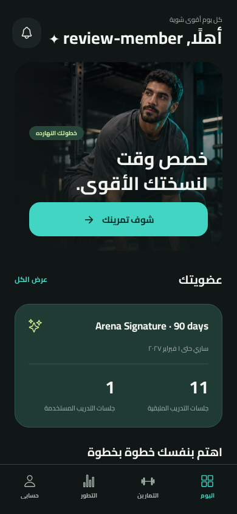
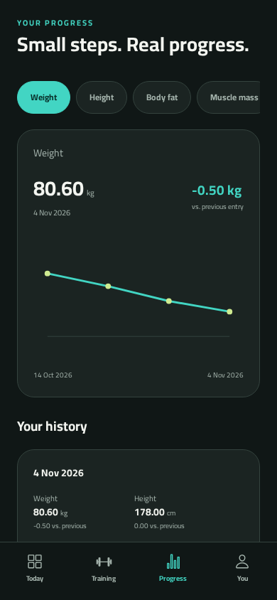

# Arena Gym · mobile v4

A new React Native + Expo application for Arena members, coaches and administrators, connected to the NestJS Arena v2 API. Arabic and English, a dark Arena teal design system, three-step introduction, native animations, protected navigation and encrypted device sessions.

The source specification is `arean.pdf` in [arena-gym](https://github.com/Wingital-Company/arena-gym). The implementation plan and acceptance checklist are in [docs/IMPLEMENTATION.md](docs/IMPLEMENTATION.md). Review evidence and release boundaries are in [docs/REVIEW.md](docs/REVIEW.md).

| Welcome | Member home | Progress |
| --- | --- | --- |
|  |  |  |

## Run

Node 24 is required. Install the exact dependencies with the committed lockfile:

```sh
nvm use
npm ci
cp .env.example .env.local
npm start
```

`EXPO_PUBLIC_API_URL` defaults to `https://test-api.arenagym-om.com`. This is a **public URL**, not a secret. Passwords and tokens never belong in build variables. The app talks directly to the API with bearer authentication; it does not use Next.js BFF cookies or the old WordPress API.

Use a development build for SDK 58:

```sh
npx eas-cli login
npx eas-cli build --profile development --platform android
# or, with Android SDK / Xcode configured locally:
npm run android
npm run ios
```

The existing app identity is retained: `com.arenagym.app`, EAS project `b6642ad0-4188-4fe2-99e2-ca2b877f3d97`. Version 4 uses a separate runtime and does not publish an update to the old application. Production builds require an explicit HTTPS `EXPO_PUBLIC_API_URL` in the EAS production environment.

## Features

| PDF requirement | Mobile implementation |
| --- | --- |
| Admin-created accounts | Member and staff forms, branch and coach selection, optional profile details. No public self-registration. |
| Plans and categories | Create/edit/delete categories and plans, gym/PT/bundle, duration, price, sessions, description. Separate component validity is shown only for bundles. |
| Classes | Coach, branch, linked memberships, weekdays, start/end time and date, capacity, booking; create/edit/delete for admins. |
| Attendance | Staff records gym/PT/class attendance; member history; server-controlled session balance deductions. |
| Workouts | Exercise library/video links, nested exercise prescriptions with sets/reps/weights/day, workout creation/editing and member assignment. |
| Nutrition | Nested meals, food quantities, times and notes; member-specific plans; member meal view. |
| Measurements | All 12 backend measurements, dated entries, history, per-entry differences and real-data trend charts. |
| Member profile | Membership/current/upcoming/last-expired, used/remaining PT sessions, assigned coach and contact, workouts, meals, progress, invoice summaries and attendance. |
| Coach | Assigned clients, client records, training assignment, meals, measurement entry, own classes/PT schedule. |
| POS | Member and multi-plan selection, gym/PT/bundle filters, start date, discount/tax, server quote, cash/card/transfer, partial/full/unpaid sale and confirmation. |
| Invoices/payments | Filter by status/search/date, detail, collection, number/member/branch/date/line/discount/tax/note corrections, complete payment-list corrections with concurrency stamp/reason. PDF/manual WhatsApp sharing from staff accounts. |
| Reports | Invoice-date profit, collected revenue, membership sales, outstanding balances, member status; branch/date/granularity filters. |
| Additional existing API features | Class booking/cancellation, notices, internal messages, password change. |

Administrative finance controls remain subject to server authorization. Member invoices are summaries from `/me/invoices`; the backend currently grants detailed invoice/PDF/share operations to finance roles. The UI does not bypass that restriction.

## Architecture

- `app/`: Expo Router entry, public intro/login, protected stack, four role-aware tabs and guarded detail routes.
- `mobile/components/`: bilingual, accessible controls; searchable paginated reference picker; loading/empty/error states; Reanimated press/card motion.
- `mobile/screens/`: member, coach and administration workflows.
- `mobile/api/client.ts`: injectable, tested client; single-flight refresh, late-401 handling, generation checks against logout races, bounded response validation and request deadlines. Writes never retry on network errors.
- `mobile/state/`: preferences, session and in-memory TanStack Query cache. Cache clears on identity changes/logout. Native foregrounding refreshes stale queries.
- `packages/contracts/`: source snapshot of the backend's exact Zod contracts, with provenance in `docs/contracts-source.json`. No private Git dependency or sibling repo is needed to build the app.
- `src/`, `locals/`, `App.js`: preserved legacy migration reference, excluded from the new entry point and EAS builds.

To refresh contracts intentionally after a backend change:

```sh
npm run sync:contracts -- ../arena-gym
npm run check
```

Dates are calendar strings in `Asia/Muscat`. OMR values remain decimal strings with three fractional digits. The UI uses server checkout totals. External media accepts only HTTP(S) URLs. Training imagery is original, generated for this project; the original Arena logo and licensed Cairo fonts remain in use.

## Verification

```sh
npm run check                 # strict TypeScript and contract/session tests
npx expo-doctor
npm run export                # Android, iOS and web JavaScript bundles
npm run test:live             # disposable MariaDB + actual Nest API + browser journeys
```

`test:live` requires Docker, a built sibling `../arena-gym` backend with dependencies installed, and free ports 3317/3105. It creates a new temporary MariaDB container and **never loads the backend .env, resets an existing database, or writes to staging**. It removes its own container when finished. Playwright forwards requests to that local API; screenshots contain only synthetic review data. It does not validate native-device performance, OS permissions, native keyboard behavior or store signing.

For a manual local review, keep `npm run review:api` running, then in another terminal:

```sh
EXPO_PUBLIC_API_URL=http://127.0.0.1:3105 npx expo export --platform web
npm run preview
```

Open `http://127.0.0.1:8082`. Disposable accounts: `review-member`, `review-coach`, `review-admin`; password `ArenaReview#2026`. These accounts exist only in the temporary local review database. Stop the API command to remove that database. Export again without the local variable before using a staging build.

## Release gates

Native signing/builds need access to the existing EAS owner/project and Apple/Google credentials. This workspace is not logged into EAS and has no Android emulator or Xcode, so a signed APK/IPA, physical-device acceptance and store publication have **not** been performed. Complete the device checklist in `docs/REVIEW.md` before release.

Automatic WhatsApp/email/SMS delivery and payment-gateway charging remain inactive as specified by the existing backend handoff. Manual sharing opens a user-controlled destination; recording a payment is not a bank charge or refund.
